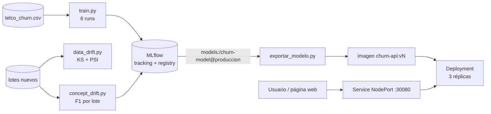
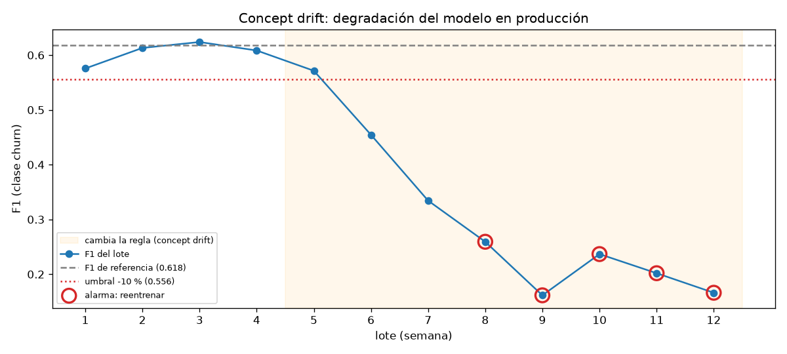

# Documento de arquitectura — churn-mlops

## 1. Resumen

El proyecto predice si un cliente de una telefónica va a darse de baja (churn) y cubre todo el ciclo del modelo: entrenamiento con trazabilidad en MLflow, empaquetado en Docker, despliegue con 3 réplicas en Kubernetes y pruebas automáticas que detectan cuándo el modelo deja de servir.

## 2. Problema y datos

| | |
|---|---|
| Dataset | Telco Customer Churn (Kaggle), 7.043 clientes |
| Variables | 19: 3 numéricas (`tenure`, `MonthlyCharges`, `TotalCharges`) y 16 categóricas |
| Objetivo | `Churn` (1 = se fue). Clases desbalanceadas: 26,5 % de churn |
| Limpieza | `TotalCharges` viene vacío en 11 clientes con 0 meses de antigüedad → se completa con 0. `SeniorCitizen` se trata como categórica |
| División | 80 % entrenamiento / 20 % prueba, estratificada por `Churn`, semilla 42 (`src/config.py`) |

**Métrica principal: F1 de la clase churn.** Con un 26 % de positivos, la accuracy engaña: un modelo que dice siempre "no se va" acierta el 73,5 %. El F1 equilibra encontrar a los que se van (recall) con no llenar de falsas alarmas al equipo de retención (precision).

## 3. Fase 1: MLflow

### 3.1 Experimentos

`python -m src.train` registra 6 runs en el experimento `churn-entrenamiento`. Cada run guarda los hiperparámetros, la semilla, el tamaño de train y test, 5 métricas sobre el conjunto de prueba y el modelo completo (preprocesamiento + clasificador) con su firma de entrada y salida.

| Run | Modelo | F1 | ROC AUC | Accuracy | Precision | Recall |
|---|---|---|---|---|---|---|
| **logreg_C0.1** | Regresión logística, C=0.1 | **0.6176** | 0.8408 | 0.7417 | 0.5087 | 0.7861 |
| rf_300_d10 | Random forest, 300 árboles, prof. 10 | 0.6169 | 0.8383 | 0.7523 | 0.5233 | 0.7513 |
| rf_100_d5 | Random forest, 100 árboles, prof. 5 | 0.6152 | 0.8388 | 0.7381 | 0.5043 | 0.7888 |
| logreg_C1 | Regresión logística, C=1 | 0.6136 | 0.8415 | 0.7381 | 0.5043 | 0.7834 |
| logreg_C10 | Regresión logística, C=10 | 0.6130 | 0.8408 | 0.7374 | 0.5034 | 0.7834 |
| gboost_100_d3 | Gradient boosting, 100 árboles, prof. 3 | 0.5813 | 0.8434 | 0.8027 | 0.6655 | 0.5160 |

**Por qué se eligió `logreg_C0.1`:**
- Tiene el mayor F1, aunque prácticamente empata con `rf_300_d10`. Ante un empate gana el modelo más simple: es más rápido, pesa menos en la imagen y sus coeficientes se pueden explicar al negocio.
- `gboost_100_d3` tiene la mejor accuracy y AUC, pero su recall es 0,52: deja escapar a la mitad de los clientes que se van, porque no usa `class_weight="balanced"`. Es el contraejemplo de por qué no se elige por accuracy.

### 3.2 Registro y versionado

Los 2 mejores runs se registran como versiones de `churn-model`, el nombre estable del proyecto:

| Versión | Run | Alias | Uso |
|---|---|---|---|
| v1 | rf_300_d10 | `candidato` | alternativa / rollback |
| **v2** | **logreg_C0.1** | **`produccion`** | **la que sirve el clúster** |

> Run ID del modelo desplegado: **`1c8847ee215a431cae754701c7c293af`**. Se obtiene con `curl http://localhost:30080/info` o en `modelo_servido/info.json`. Se genera en cada entrenamiento.

Para cambiar de versión no se toca código: `python -m src.promover 1` mueve el alias y se reconstruye la imagen.

### 3.3 Cómo consume el servicio la versión del registro

1. `src/exportar_modelo.py` pide `models:/churn-model@produccion`, por alias y no por ruta, descarga ese modelo y escribe `info.json` con el nombre, el alias, la versión y el `run_id`.
2. El Dockerfile copia eso dentro de la imagen, que se etiqueta con la versión: `churn-api:v2`.
3. La API expone `/info`, y cada predicción incluye `modelo_version`. Desde cualquier pod del clúster se puede llegar al run exacto de MLflow que produjo el modelo.

**Decisión:** el alias se resuelve al construir la imagen y no cada vez que arranca un pod. Así la imagen es inmutable, las 3 réplicas sirven siempre la misma versión y el clúster no depende de que el servidor de MLflow esté encendido. Fuera de la imagen, por ejemplo con `uvicorn` en local, `app.py` carga directamente `models:/churn-model@produccion` del registro.

## 4. Fase 2: Docker

- `Dockerfile` propio sobre `python:3.12-slim`.
- Dependencias fijadas en `requirements-api.txt`, incluido `mlflow-skinny==3.18.0`. Es la versión liviana de MLflow, que alcanza para cargar el modelo. El entrenamiento usa `mlflow==3.18.0`, la misma versión.
- Primero se copian las dependencias y después el código, para que Docker reutilice esa capa en cada rebuild.
- El contenedor corre con un usuario sin privilegios y arranca `uvicorn` solo: `docker run -p 8000:8000 churn-api:v2` y ya responde.

## 5. Fase 3: Kubernetes

| Decisión | Por qué |
|---|---|
| `replicas: 3` | Si se cae un pod, quedan 2 atendiendo |
| `POD_NAME` desde `metadata.name` | Cada respuesta dice qué pod la atendió: así se demuestra el balanceo |
| `readinessProbe` en `/health` | El pod recibe tráfico recién cuando el modelo terminó de cargar |
| `livenessProbe` en `/health` | Si la API se cuelga, Kubernetes reinicia el contenedor |
| requests 100m / 256Mi, limits 500m / 512Mi | El scheduler reserva lo mínimo y ningún pod puede acaparar el nodo |
| `RollingUpdate` con `maxUnavailable: 0` | Al cambiar de versión nunca hay menos de 3 pods listos |
| Service `NodePort 30080` | Acceso desde la máquina (`localhost:30080` en Docker Desktop) y balanceo entre los pods con `app: churn-api` |

**Por qué el balanceo se prueba con conexiones nuevas:** el Service reparte por conexión. Si el cliente reutiliza la misma conexión (keep-alive), todas las peticiones van al mismo pod. Por eso `probar_balanceo.ps1` usa `-DisableKeepAlive`. `kubectl port-forward` tampoco sirve para esta prueba, porque siempre se conecta a un solo pod.

## 6. Fase 4: drift

### 6.1 Data drift

`src/drift/data_drift.py` compara cada una de las 19 variables del lote nuevo contra el conjunto de entrenamiento, que funciona como baseline.

| Tipo de variable | Prueba | Umbral | Por qué |
|---|---|---|---|
| Numérica | Kolmogórov-Smirnov de dos muestras | p < 0,05 / 19 = 0,0026 | Compara la distribución completa, no solo la media, y no supone normalidad. Con 19 pruebas a la vez, un 0,05 sin corregir daría una falsa alarma en casi 2 de cada 3 lotes (1 − 0,95¹⁹ = 62 %). Bonferroni deja la probabilidad de cualquier falsa alarma en ≤ 5 % |
| Categórica | PSI (índice de estabilidad poblacional) | PSI > 0,2 | Mide cuánto cambió la proporción de cada categoría. 0,1 y 0,2 son los cortes estándar de la industria (riesgo crediticio): < 0,1 estable, 0,1–0,2 vigilar, > 0,2 cambio significativo |

**Comprobación empírica del umbral:** con 200 lotes limpios de 1.000 clientes del conjunto de prueba hubo 0 falsas alarmas, y el PSI máximo fue 0,011 en el percentil 99, muy lejos de 0,2. Limitación: los 200 lotes se sacan del mismo conjunto de prueba (1.409 clientes), así que se solapan y la estimación de falsas alarmas es optimista.

**Resultados:**

| Lote | Qué se le hizo | Variables con drift | Estado |
|---|---|---|---|
| `lote_mismo_origen.csv` | 1.000 clientes del conjunto de prueba | ninguna | 🟢 VERDE (exit 0, test pasa) |
| `lote_derivado.csv` | tenure a la mitad, precios +25 %, 35 % de los clientes pasan a contrato mensual y 35 % a cheque electrónico | tenure, MonthlyCharges, TotalCharges, PaymentMethod | 🔴 ROJO (exit 1, test falla) |

En el lote derivado, `Contract` dio PSI = 0,11: está en la franja de vigilar pero no supera la alarma. Figuras: `docs/figuras/data_drift_*.png`.

### 6.2 Concept drift

**Escenario:** son 12 lotes semanales de 500 clientes. Las variables de entrada salen siempre de la misma población, así que no hay data drift. Desde la semana 5 cambia la regla que genera el churn. La empresa lanza una tarifa de retención para contratos mensuales, y parte de esos clientes que antes se iban ahora se quedan. Al mismo tiempo, un competidor se lleva a parte de los clientes con contrato largo. La intensidad crece un 15 % por semana hasta llegar al 75 %, lo que simula un drift gradual.

| Semana | 1–4 | 5 | 6 | 7 | 8 | 9–12 |
|---|---|---|---|---|---|---|
| F1 | 0,58–0,62 | 0,57 | 0,46 | 0,33 | 0,26 | 0,16–0,24 |
| Data drift | no | no | no | no | no | no |
| Alarma | — | — | bajo umbral (1) | bajo umbral (2) | **REENTRENAR** | REENTRENAR |

**Criterio de reentrenamiento:** la alarma salta si el F1 cae más de un 10 % respecto del F1 de referencia (0,618 → umbral 0,556) **durante 3 lotes seguidos**.

- **Por qué un 10 %:** con 300 lotes normales de 500 clientes, el F1 varía con una desviación estándar de 0,032. El 10 % equivale a 0,062, unas 2 desviaciones, y un lote normal cae por debajo solo por azar el 3,7 % de las veces.
- **Por qué 3 lotes seguidos:** que 3 lotes normales seguidos caigan por debajo por azar pasa aproximadamente 0,037³ ≈ 0,005 % de las veces. Esperar 3 semanas evita reentrenar por un lote malo, a cambio de detectar el problema 2 semanas más tarde. En este escenario la alarma salta en la semana 8.

El resultado también queda en MLflow (experimento `churn-monitoreo`), con `f1_lote` por semana como gráfica temporal.

### 6.3 El problema del retraso de etiquetas

En producción no se sabe si un cliente se fue hasta que termina su ciclo de facturación, es decir, semanas o meses después de la predicción. El F1 por lote solo se puede calcular con ese retraso. Mientras tanto, el equipo haría esto:

1. **Vigilar lo que sí se ve al instante:** el data drift de las entradas (KS y PSI en cada lote) y la distribución de las predicciones (tasa de churn predicha y probabilidades medias). Si cambian, se adelanta la revisión.
2. **Medir con etiquetas parciales:** usar los clientes cuyo resultado ya se conoce, por ejemplo los que tenían que renovar este mes, como muestra temprana, sabiendo que está sesgada.
3. **Cerrar el ciclo cuando llegan las etiquetas:** recalcular el F1 de cada lote con su retraso y aplicar el criterio de reentrenamiento.

**Limitación que muestra la simulación:** en este concept drift la tasa de churn predicha (~0,40) y la real (~0,25) **no cambian**, porque la regla nueva mueve clientes en los dos sentidos, y el data drift sigue en verde. Ninguna señal sin etiquetas habría detectado el problema. Por eso las métricas proxy sirven como alerta temprana, pero no reemplazan medir con las etiquetas reales.

## 7. Puntos extra: interfaz

`frontend/index.html` lo sirve la misma API en `/`. Desde el clúster se abre en `http://localhost:30080`, llama a `/info` y a `/predict` del Service de Kubernetes y muestra qué pod respondió cada predicción. Así se ve que el consumo es contra el servicio desplegado y no contra un proceso local.

## 8. Reparto de trabajo

Trabajo individual.

| Integrante | Componentes |
|---|---|
| `Pablo Calderon Lopez` | Todos: datos, entrenamiento y MLflow, API, Docker, Kubernetes, data drift, concept drift, pruebas, interfaz y documentación |

## 9. Evidencias

Las capturas van en `docs/evidencias/`:

- [x] MLflow: experimento con los 6 runs ordenados por F1
- [x] MLflow: vista Compare de varios runs
- [x] MLflow: Model Registry con v1 y v2 y el alias `produccion`
- [x] `docker run` respondiendo una predicción
- [x] `kubectl get pods -n churn -o wide` con 3 pods Running
- [x] `probar_balanceo.ps1` con peticiones repartidas entre pods distintos
- [x] Autorreparación: pod borrado, pod nuevo y `vigilar_servicio.ps1` sin FALLA
- [x] Escalado a 5 réplicas y vuelta a 3
- [x] `pytest -v` todo verde
- [x] Data drift ROJO con `lote_derivado.csv`
- [x] Gráfica de concept drift y el experimento `churn-monitoreo` en MLflow
- [x] Página web desde `localhost:30080` mostrando el pod
